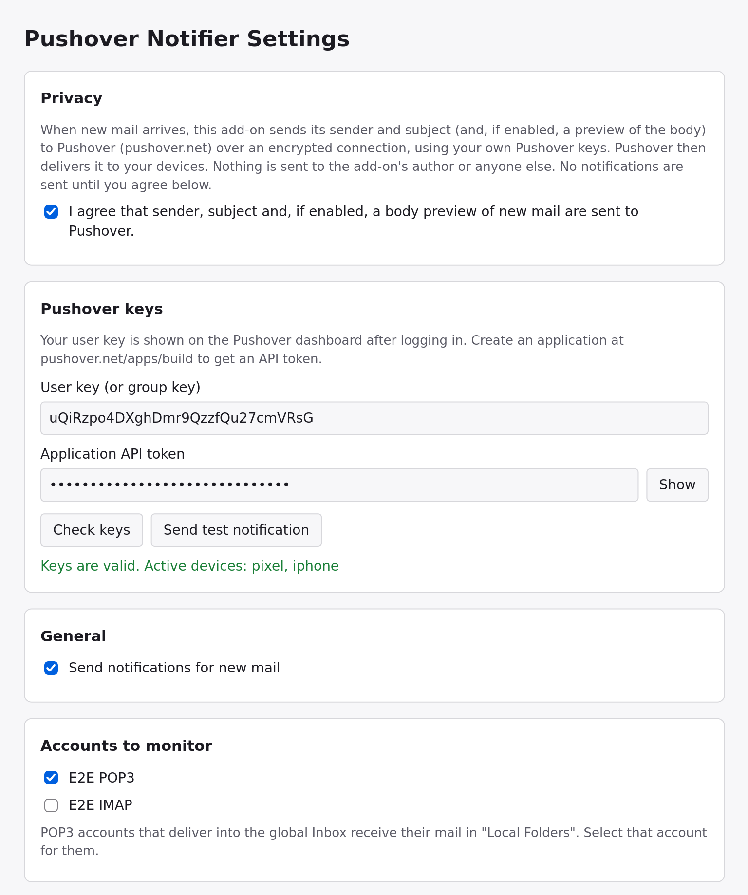
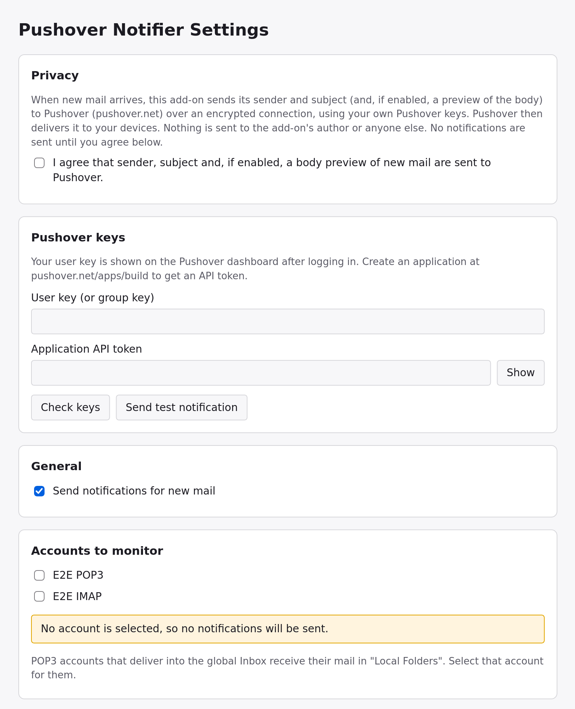
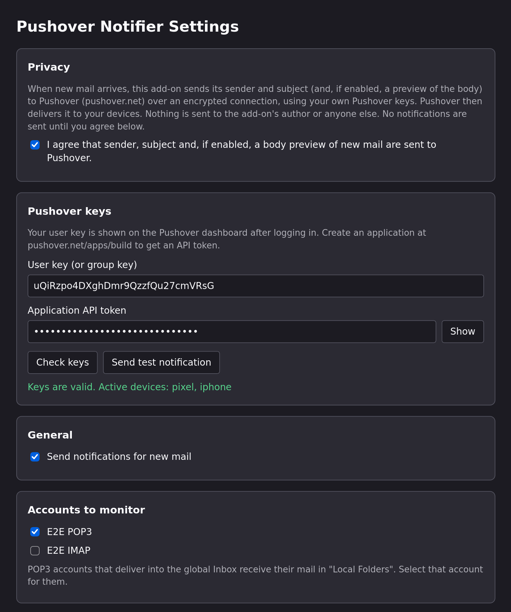

# Pushover Notifier – Thunderbird Add-on



Sends a [Pushover](https://pushover.net) notification to your phone (or any other Pushover device) when new mail arrives in Thunderbird. It is useful for mail accounts that don't allow forwarding.

This add-on is not affiliated with or endorsed by Pushover. It was created independently. Use at your own risk.

## Features

- A notification per new mail: the **sender** as title, the **subject** as message, and the mail's date as timestamp.
- **Only mail that stays in the Inbox after your message filters ran** (optional). Mail your filters move to another folder, delete or mark as junk does not notify you.
- An optional **body preview**, also for HTML-only mail, trimmed to Pushover's 1024-character limit.
- **Burst summary**: when many mails arrive at once (e.g. at startup), you get one summary instead of dozens of pushes.
- Choose which **accounts** to monitor, skip junk, and filter by **sender** or **subject** (several terms, case-insensitive).
- Pushover **priority** (including emergency with retry and expire), **sound** (including your custom sounds) and target **device**.
- Settings page with **key check**, **test notification** and the result of the last delivery.
- English and German user interface.

## Requirements

- Thunderbird **140 or newer** (140 ESR, 153 ESR or the current release). Thunderbird 128 users can keep using version 1.3.3.1.
- A Pushover account (user key) and a Pushover application (API token). You can create one at <https://pushover.net/apps/build>.

## Setup

1. Install the add-on. Its settings page opens automatically. You can also reach it later via *Add-ons and Themes → Pushover Notifier → Options*.
2. Read the privacy notice and tick the consent checkbox.
3. Enter your **user key** and **API token**. Use **Check keys** to verify them (Thunderbird asks once for permission to access `api.pushover.net`), and **Send test notification** to see a push arrive.
4. Select the **accounts** to monitor and click **Save settings**.

## Settings



| Setting | Meaning |
|---|---|
| Send notifications for new mail | Master switch. |
| Accounts to monitor | Only mail in these accounts notifies you. POP3 accounts that use the global Inbox deliver into *Local Folders*, so select that account for them. |
| Only notify for mail that stays in the Inbox after message filters ran | See [Inbox-only mode](#inbox-only-mode). Without it, new mail in the Inbox and in normal folders notifies you. Special folders like Junk, Trash, Sent or Archives never do. |
| Skip mail marked as junk | No notification for mail Thunderbird classified as junk. |
| Only mail from senders / with subjects containing | One term per line. A mail must contain at least one term; case doesn't matter. Empty means all mail. |
| Include a preview of the mail body | Adds the start of the body. *Maximum preview length*: 0 means as much as fits into Pushover's 1024 characters. |
| Show the account name in the title | Useful when you monitor several accounts. |
| Send one summary when at least N mails arrive at once | 0 turns summaries off. |
| Priority, Sound, Device | Passed to Pushover. *Load sounds from Pushover* adds your custom sounds. *Device* can be left empty to send to all devices. |
| Emergency: repeat every / stop after | Only for emergency priority. Pushover requires at least 30 s between repeats and at most 10800 s (3 h) in total. |
| Debug messages | Writes details to *Tools → Developer Tools → Error Console*. Keys and mail contents are never logged. |

The *Last notification* section shows the result of the last delivery. All settings at a glance, with a failed delivery: [full settings page](docs/screenshots/options-delivery-error.png). The page follows Thunderbird's dark mode and is available in German; all screenshots are in the [gallery](docs/screenshots/README.md).



## Inbox-only mode

Thunderbird reports new mail after running your message filters and junk classification. However, some filters act later: filters set to run *after junk classification*, and moves on IMAP servers that take a moment to complete. Thunderbird also reports each mail only once, in the folder where it first landed.

With **Only notify for mail that stays in the Inbox** enabled, the add-on therefore:

1. ignores new mail reported in any folder other than an Inbox,
2. waits about 5 seconds,
3. searches the Inbox for each mail (by its Message-ID) and only notifies you about those still there that were not marked as junk in the meantime.

This is tested with POP3 and IMAP accounts and with all these filter kinds: moving to a folder, moving *after junk classification*, deleting, and marking as junk. See [Development](#development).

Known limits:

- The Inbox is checked once, about 5 seconds after Thunderbird reported the mail. A filter move that is still running then can still produce a notification: most likely a filter that runs *after junk classification* on an IMAP account, because it acts last and the move happens on the server (a slow server or a busy computer). On Thunderbird 140, IMAP filters that run *after junk classification* only run at the next folder update, so that mail notifies every time. Listening for the move doesn't help: the notification has been sent by the time the move completes, and Pushover can't take it back.
- With the IMAP delete model *"Just mark it as deleted"*, a mail moved away on a server without MOVE support stays in the Inbox (marked as deleted) and may still notify you.
- Notifications arrive a few seconds later than without this mode.

## Privacy

For each new mail that passes your settings, this add-on sends the **sender**, **subject** and, only if you enable it, a **preview of the body** to Pushover (`api.pushover.net`). It sends them over HTTPS, using your own Pushover user key and API token. Pushover then delivers the notification to your devices; see [Pushover's privacy policy](https://pushover.net/privacy).

Nothing is sent to the add-on's author or to anyone else, and the add-on collects no statistics. The keys and settings are stored locally in your Thunderbird profile. The add-on sends nothing until you give your consent on its settings page.

## Development

The add-on is plain JavaScript (ES modules) without a build step.

```sh
npm install        # installs web-ext (dev only)
npm test           # unit tests (node:test)
npm run test:e2e   # end-to-end tests in real Thunderbird builds (needs Docker)
scripts/e2e.sh     # the same, keeping the log and screenshots in $ARTIFACTS
npm run lint       # web-ext lint; warnings about "messagesRead"/"accountsRead" (Thunderbird-only permissions) and Firefox for Android are expected
npm run build      # creates web-ext-artifacts/pushover-notifier-<version>.xpi
```

To try it out, open *Tools → Developer Tools → Debug Add-ons* in Thunderbird, click *Load Temporary Add-on…* and select `manifest.json`.

### End-to-end tests

`npm run test:e2e` (`tests/e2e/run.sh`) runs the add-on in headless, official Thunderbird builds inside Docker. By default it uses the oldest supported ESR (140) and the current release in English, plus the current release in German. Everything runs locally, and no real mail or Pushover account is involved:

- Mail comes from a small POP3 server (`tests/e2e/servers.mjs`) and from [GreenMail](https://greenmail-mail-test.github.io/greenmail/) over IMAP. The test accounts have message filters that move, delete and junk-mark mail.
- `api.pushover.net` is a local mock that behaves like the real API, including its CORS headers. Thunderbird reaches it through a proxy with a throwaway test certificate.
- Thunderbird is driven through Marionette (`tests/e2e/marionette.mjs`).

The scenarios (`tests/e2e/e2e.mjs`) cover:

- the upgrade from 1.3.3.1 (with and without keys) and a fresh install,
- notification content: title, body preview and its limit, priority, sound, device, timestamp,
- Inbox-only mode with every filter kind, on POP3 and IMAP, and skipping junk,
- summaries, sender and subject filters, every reason not to send (account, consent, switch, keys), and Pushover errors (rejected, retried),
- the settings page: its buttons, input checks and error messages, its permission prompt (allowed and denied), in light and dark mode, and after a fresh install,
- that keys and mail contents never show up in the console.

Which feature is checked where: [`tests/e2e/COVERAGE.md`](tests/e2e/COVERAGE.md).

Useful variables:

- `TB_BUILDS="latest:de"` picks the builds to test (`<version>:<language>`; `latest` is the current release).
- `E2E_VERBOSE=1` shows Thunderbird's console.
- `E2E_ARTIFACTS=<dir>` saves screenshots of the settings page (in `<dir>/<version>-<language>/`).

### Screenshots

The screenshots in `docs/screenshots/` ([gallery](docs/screenshots/README.md)) are taken by the end-to-end test. To regenerate them (needs Docker):

```sh
scripts/docs-screenshots.sh            # writes docs/screenshots/*.png
scripts/docs-screenshots.sh /tmp/shots # or somewhere else
```

It runs the end-to-end test in the current Thunderbird release in English and German and keeps the English set plus the German `options-settings.de.png`. If a check fails, it still copies the screenshots, then exits with an error; the log names the check. Shrink the PNGs with `oxipng -o 4 --strip safe docs/screenshots/*.png` before committing. On GitHub, the manual *Docs screenshots* workflow does the same and returns them as an artifact.

### Layout

- `background.js`: event page. It receives `messages.onNewMailReceived`, queues mail, runs the Inbox check and sends notifications.
- `modules/`: settings, notification formatting, mail helpers, Pushover client and i18n. The pure parts are unit-tested in `tests/`.
- `options/`: the settings page.
- `_locales/`: translations.
- `tests/e2e/`: the end-to-end tests.
- `scripts/docs-screenshots.sh`: regenerates `docs/screenshots/`.
- `scripts/e2e.sh`: runs the end-to-end test with its log and screenshots in `$ARTIFACTS`.
- `.github/workflows/`: CI (unit tests, lint, build, and the end-to-end test, one job per Thunderbird build) and the manual *Docs screenshots* workflow.

## License

MIT, see [LICENSE](LICENSE).
