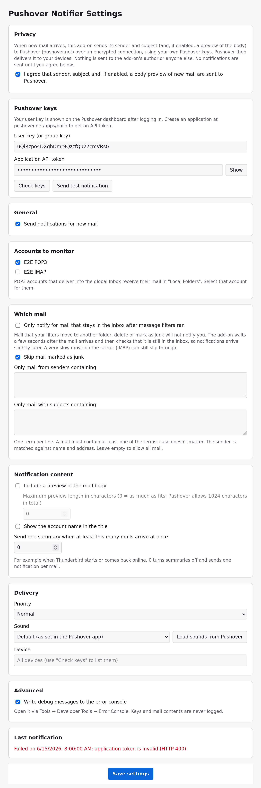
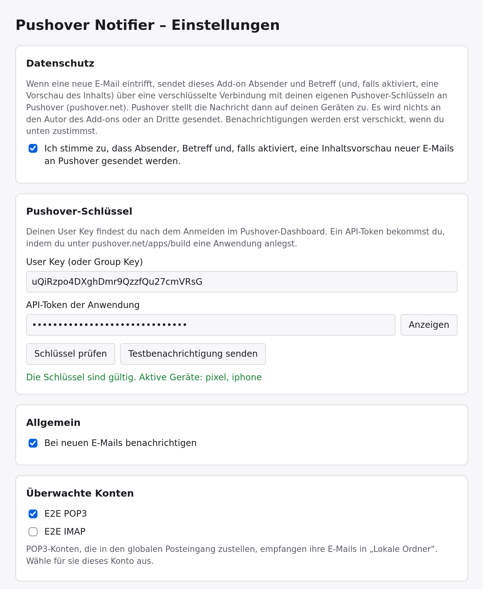

# Screenshots

The add-on has one screen, its settings page (*Add-ons and Themes → Pushover Notifier → Options*). These screenshots come from the end-to-end test in the current Thunderbird release, with test accounts and a local Pushover mock. Regenerate them with `scripts/docs-screenshots.sh` (see [Screenshots](../../README.md#screenshots)).

## After a fresh install

The settings page opens by itself after installing. Nothing is sent until you tick the consent checkbox, enter your keys and select at least one account.

## Keys checked

*Check keys* verified the keys and listed the devices; one of the two accounts is monitored.

## All settings, with a failed delivery

The whole page. *Last notification* at the bottom shows the last delivery, here an error Pushover returned for an invalid application token.

## Dark mode

The page follows Thunderbird's light or dark color scheme.

## German

The user interface is available in English and German.

